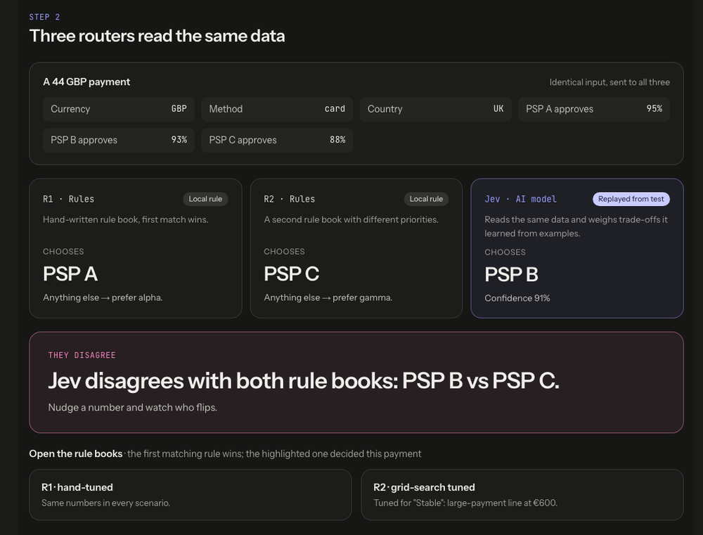
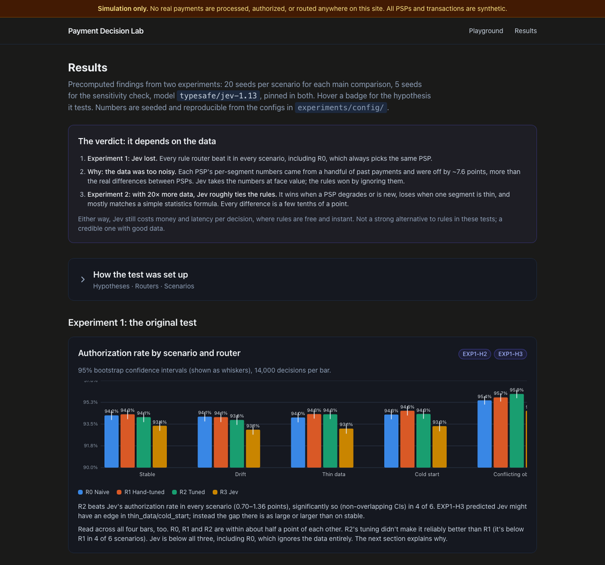

# Payment Decision Lab

[](https://github.com/sdogantekin/jev-orchestrator/actions/workflows/ci.yml)

A simulation-only experiment testing one question:

> Can Jev, a probabilistic decision model from TypeSafe, be a strong alternative to
> rule-based decision making in payment orchestration?

The idea started from a public claim that Jev is weak at content generation like typical LLMs
but very good at decisions based on a given data set — **claimed by TypeSafe/OpenRouter, tested
here.**

Live site (Playground and Results): https://jev-orchestrator.serkandogantekin.com

## The short answer: it depends on the data

Two experiments, each with hypotheses committed before its run
([`docs/hypotheses.md`](docs/hypotheses.md), [`docs/hypotheses-v2.md`](docs/hypotheses-v2.md)):

1. **Experiment 1: Jev lost.** Every rule-based router beat it on authorization rate in all 6
   scenarios, including the router that always picks the same PSP.
2. **Why:** the observed data each router sees was noisier than the real differences between
   PSPs (a PSP's per-segment rate came from a median of 8 past attempts). Jev takes the numbers at
   face value. The rules won mostly by ignoring them.
3. **Experiment 2: with 20x more data, Jev roughly ties the rules.** Same world, scenarios,
   streams, seeds and model. Jev gains about one point everywhere, wins when a PSP degrades or is
   new, and loses when one segment is thin. Every difference is a few tenths of a point.

Either way, Jev costs money and 200ms or more per decision, where rules are free and instant.
The full report is [`EXPERIMENT.md`](EXPERIMENT.md); Experiment 2's scored results are in
[`docs/results-v2.md`](docs/results-v2.md).

## What it looks like

The Playground replays a recorded decision, or makes a live call to Jev with your own numbers. Two
hand-written rule books and the AI read the same data, and the page highlights when they disagree.



The Results page holds the numbers of both experiments, with the verdict at the top.



## How this was built (with an AI assistant)

The project is a human-led collaboration with AI assistants (Claude). The way of working matters
as much as the result, so it is written down:

- **Requirements first.** Before any code, the question, the locked decisions (metric, scale,
  train/test split), the safety boundary, the hypotheses and the stop-and-report checkpoints were
  written down together with an AI assistant: [`REQUIREMENTS.md`](REQUIREMENTS.md),
  unchanged since 2026-10-07 (the "section N" references in code comments point to it).
  [`docs/requirements-status.md`](docs/requirements-status.md) records what was met, what changed
  and why, and what was not done.
- **Predictions before runs.** The hypotheses were committed before the first run, and again, with
  a pass rule for each, before Experiment 2, so the results could not be bent to fit afterwards.
- **One checkpoint at a time.** The AI coding agent built each step (simulator, rule routers, Jev
  adapter, pilot, full run, web page) and stopped to report. The project owner made the calls that
  changed the plan, which are logged in [`docs/assumptions.md`](docs/assumptions.md). Commits carry
  `Co-Authored-By` trailers.
- **Guardrails around cost and silent errors.** Tests never call the live API, and recorded
  responses replay without cost. Experiment 1 started with a one-seed pilot, Experiment 2 was
  rehearsed with a fake Jev that makes no network calls and estimates the cost, and the Experiment 2
  batch script stops if a whole seed fails.
- **Mistakes were caught, fixed and written down.** The first R2 tuning overfit a single stream and
  was redone on pooled seeds. A stale results file was caught while building the Results page. The
  first explanation of why Jev lost was only part of the story, which led to Experiment 2. A note
  claiming that a code change affected no published number was wrong and was corrected.

## This app never touches real payments

- It never processes, authorizes, captures, refunds, routes, or executes a real payment.
- It never connects to a real PSP, merchant account, card network, bank, or acquirer.
- PSPs (`PSP Alpha`, `PSP Beta`, `PSP Gamma`) are entirely simulated. Nothing implies a live
  integration.
- No real PAN, CVV, token, bank account, cardholder data, or production transaction data is
  accepted or stored anywhere.
- All results, fees, latency, retries, declines, and chargebacks come from the simulator.

## What's here

- **The experiments**: a seeded simulator (`lib/simulation/`) and four routers — R0 (naive), R1
  (hand-tuned rules), R2 (grid-search–tuned rules), R3 (Jev) — compared across 6 scenarios.
  Experiment 1 adds probes, a data-richness comparison and a sensitivity check. Experiment 2
  reruns the comparison with 20x more observed data and adds a simple statistics reference
  router. Batch scripts live in `experiments/scripts/`; results in `experiments/results/`.
- **The Playground**: pick a preset scenario example (free, instant, replays a real recorded
  decision) or craft your own transaction and PSP stats (makes a real, rate-limited live call to
  Jev).
- **The Results page**: the precomputed findings as charts and tables, each linked to the
  hypothesis it tests.

## Running locally

```bash
npm install
npm test          # unit tests (no network access, no live Jev calls)
npm run dev        # the web app at http://localhost:3000
npm run build      # production build
```

Copy `.env.example` to `.env` and fill in `OPENROUTER_API_KEY` to use the Playground's live
"custom inputs" mode. Everything else in the app — the Results page, the Playground's preset
examples, and the whole test suite — works without any key, since all of that replays committed,
real recorded data.

`UPSTASH_REDIS_REST_URL` / `UPSTASH_REDIS_REST_TOKEN` are optional: without them, the
Playground's rate limiting falls back to an in-memory counter, which is fine for local dev but
not for a real deployment (resets on restart, not shared across instances).

### Reproducing the experiment

The batch scripts under `experiments/scripts/` are what generated everything in
`experiments/results/`. They make real, billed calls to Jev (the pilot and main comparison alone
cost a few dollars total) and are not something to run casually:

```bash
npm run pilot           # one scenario, one seed — sanity check before anything bigger
npm run probes          # the 4 live probes (calibration is derived separately, for free)
npm run jev-main-batch  # the full 6-scenario x 20-seed comparison
npm run data-richness   # levels 1-3 on stable and drift
npm run sensitivity     # 9 world-design variants on stable
```

Experiment 2 and the diagnosis scripts are run directly:

```bash
npx tsx experiments/scripts/v2-design-check.ts      # free: rules only, checks the 20x-data world
node --env-file=.env ./node_modules/.bin/tsx experiments/scripts/run-jev-v2-batch.ts --dry-run   # free: fake Jev, estimates cost
node --env-file=.env ./node_modules/.bin/tsx experiments/scripts/run-jev-v2-batch.ts             # the paid Experiment 2 run
npx tsx experiments/scripts/v1-diagnosis.ts         # free replay: why Jev lost in Experiment 1
npx tsx experiments/scripts/v2-seed-level-check.ts  # free replay: stricter error margins
```

The two replay scripts need the recorded responses described below.

Every live Jev response is cached locally by state hash and recorded as a fixture under
`experiments/fixtures/` (gitignored — not committed, see `docs/assumptions.md` #11), so rerunning
any script only pays for states it hasn't already seen. Because they aren't in the repo, a fresh
clone can rerun the rule-only scripts for free, but replaying Jev's answers means paying for the
calls again.

## Limitations

- This project does not prove that Jev improves real-world payment routing.
- The simulator is synthetic; conclusions depend on how the world was designed (see the
  sensitivity check on the Results page for how much that matters here).
- The simulated world leaves little room to win: a router that knows the true probabilities
  beats the hand-tuned rules by only about half a point.
- Experiment 2 tests one data volume (20x). Other volumes are untested.
- Observed data comes from a background history independent of routing choices, so exploration
  and feedback loops are not tested.
- Only one decision type — PSP selection for a first attempt — is tested.
- Results apply to one model version (`typesafe/jev-1.13`, pinned) at one point in time
  (October 2026). A newer `typesafe/jev-1.14` exists and is untested.
- The sensitivity check uses 5 seeds on one scenario, fewer than the main results, to keep the
  number of paid Jev calls bounded.
- Jev's probabilities are model outputs, not guarantees or calibrated odds — see the
  calibration finding on the Results page.
- Currency conversion uses fixed simulation constants, not market rates.
- A real payment router needs far more data, controls, monitoring, resilience, compliance
  review, and domain optimization than anything here.

See `docs/assumptions.md` for every implementation judgment call made where the requirements
doc was silent, and `docs/jev-api-notes.md` for what was verified against the live Jev API
before building the adapter.

## License

MIT, see [`LICENSE`](LICENSE).
